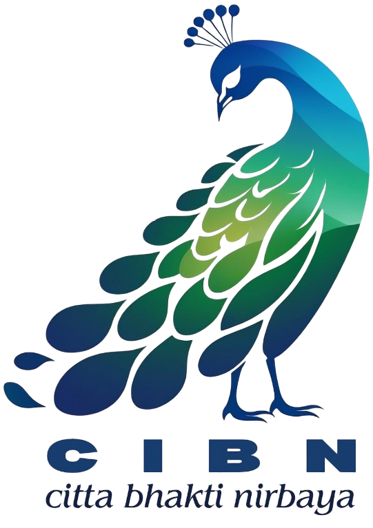
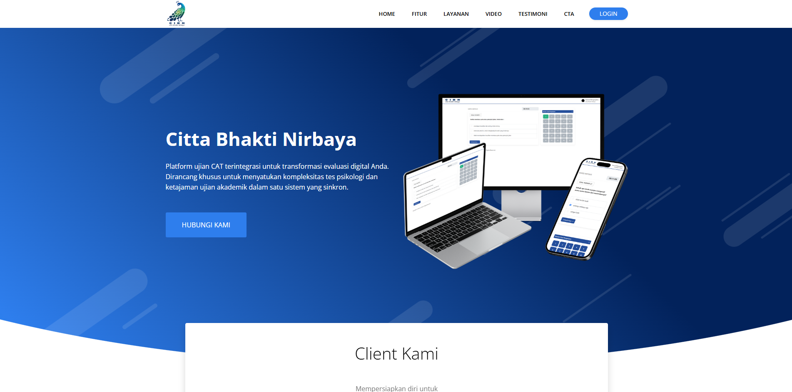
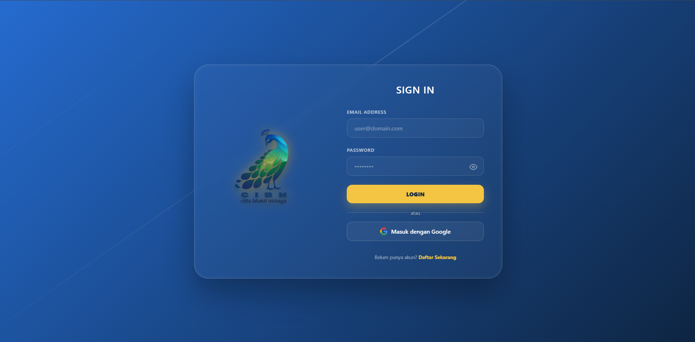
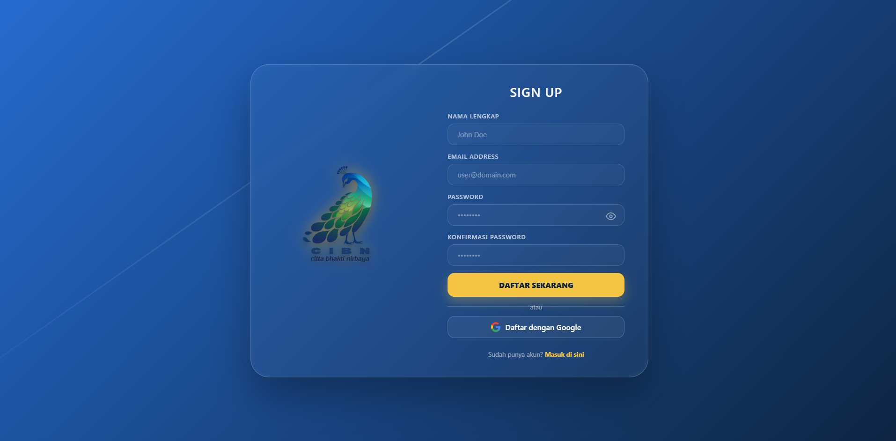

  

<h1 align="center">Citta Bhakti Nirbaya</h1>

  Platform ujian CAT untuk tes psikologi dan ujian akademik dalam satu sistem.

  <a href="https://www.cittabhaktinirbaya.com"><b>www.cittabhaktinirbaya.com</b></a>

---

## Tampilan

| Masuk | Daftar |
|---|---|
|  |  |

## Tentang proyek

Citta Bhakti Nirbaya (CIBN) dipakai untuk menjalankan ujian berbasis komputer. Admin menyiapkan soal dan modul, lalu membagikan kode ujian. Peserta masuk, memasukkan kode, dan mengerjakan modul satu per satu sesuai urutan. Hasilnya bisa dilihat admin dan reviewer. Halaman depan juga bisa diubah langsung dari panel admin.

## Alur ujian

1. Admin membuat soal dan menyusunnya ke dalam modul
2. Admin membuat kode ujian dengan tanggal mulai, tanggal selesai, dan durasi
3. Peserta masuk, lalu memasukkan kode ujian
4. Peserta mengerjakan modul secara berurutan dengan timer berjalan
5. Hasil muncul di laporan, dan reviewer bisa melihat jawaban per modul

## Fitur

### Admin
- Dashboard dan manajemen akun peserta: buat satu per satu, buat massal, ubah, hapus, dan kelompokkan dalam grup
- Soal pilihan ganda: input manual atau impor dari dokumen Word memakai template
- Soal angka hilang
- Kumpulan modul dengan pengaturan durasi waktu
- Kunci jawaban, termasuk mode ujian yang tidak bisa kembali ke soal sebelumnya
- Pembuatan kode ujian
- Laporan hasil per kode dan per peserta
- Pengelola landing page: banner, fitur, klien, layanan, video, testimoni, dan tombol ajakan

### Reviewer
- Melihat jawaban peserta per kode dan per modul
- Halaman pembahasan ujian

### Peserta
- Masuk dengan email dan kata sandi, atau dengan akun Google
- Mengerjakan modul sesuai urutan
- Jawaban terakhir dipulihkan kalau keluar lalu masuk lagi
- Riwayat dan hasil ujian
- Atur ulang kata sandi lewat email

## Teknologi

- PHP dan Laravel
- MySQL atau PostgreSQL
- Blade, Tailwind, Alpine.js, dan Vite
- Tes otomatis untuk alur autentikasi

## Link

[www.cittabhaktinirbaya.com](https://www.cittabhaktinirbaya.com)
